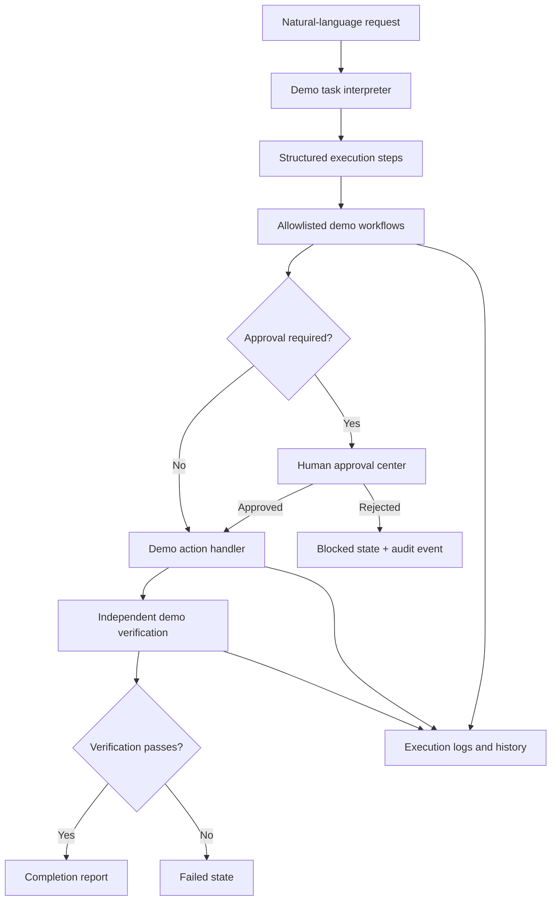

# CentrAlign AI — Autonomous AI Employee

A focused prototype for the CentrAlign AI engineering assignment. It demonstrates a task workspace, invoice processing, overdue invoice reporting, support-draft workflows, human approval, controlled failure scenarios, and an execution inspector.

## Current implementation

- Responsive enterprise dashboard and task workspace.
- Deterministic demo task interpreter for invoice, reporting, support, and unsupported financial-transfer requests.
- Bounded, visible execution steps with logs and status.
- Approval queue for finance writes and support drafts.
- Approve/reject interactions; rejected actions are blocked.
- Overdue invoice totals calculated in application code from seeded fictional records.
- Controlled transient-failure/retry and verification-mismatch demonstrations.
- Task history, business data, settings and execution log views.

## Important prototype limitations

This first version is a front-end demo with in-memory/session state. It is not yet a production-grade autonomous agent: task records are stored in browser memory and reset on refresh; finance/support records are represented by the demo workflow rather than a managed persistent database; no external LLM provider, browser automation, or real company connector is enabled. The UI explicitly labels demo mode. Do not use it with real business records.

## Run locally

Requirements: Node.js 18.17+.

```bash
npm install
npm run dev
```

Open http://localhost:3000.

## Build

```bash
npm run build
npm start
```

## Demo walkthrough

1. Open Task workspace.
2. Select “Process an invoice” or enter: `Find the latest invoice from Acme Technologies and record it in finance.`
3. Click Run task. Inspect the plan and logs.
4. Open Approval center and approve or reject the action.
5. Run `Find all overdue invoices and calculate the total outstanding amount.` to see deterministic calculations.
6. In Task workspace, enable “Transient tool failure + retry” and run an invoice task.
7. Enable “Verification mismatch” and run an overdue report to see that failed verification prevents completion.
8. Try `Transfer money from the company bank account.` to see an unsupported request blocked safely.

## Deployment

This is a standard Next.js app and can be imported into Vercel. For this demo build, no secrets or database are required. Deployment will host the UI, but because state is in memory, it must not be presented as durable multi-user storage.

For a production version, add:
- A managed database and repository layer.
- Authentication and tenant isolation.
- Server-side orchestration with persisted task state.
- A real LLM planning adapter with Zod-validated structured outputs.
- Tool execution APIs with permission enforcement.
- Independent read-after-write verification.
- Durable queues, idempotency keys, timeouts, and retry policy.
- Automated unit and integration tests.
- Server-side audit log storage.

## Security notes

- Demo records are fictional.
- No bank transfer, real email, or third-party system integration exists.
- The app does not accept API keys in the UI.
- Approval is a prototype interaction and is not a substitute for server-side authorization in production.

## Architecture



## Tech stack

- Next.js 14 App Router
- React 18
- TypeScript
- Lucide icons
- Custom CSS design system

## License

Use and adapt for educational and interview demonstration purposes.
